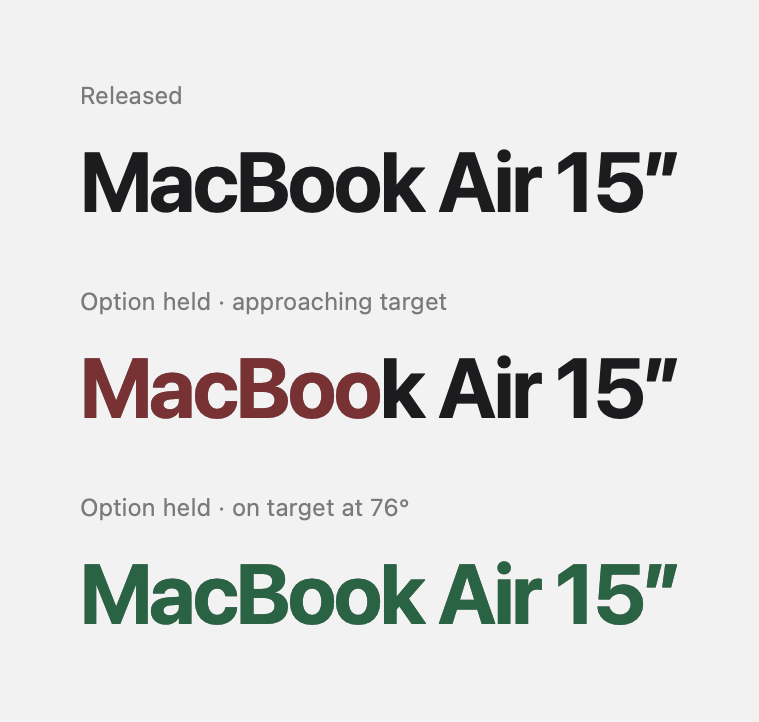

# mbangle

An independent native macOS prototype that demonstrates discreet lid-angle alignment within a product-style interface. Alignment feedback appears only when you ask for it. This is a personal demonstration project, not an Apple product or an Apple-approved tool.

Hold **Option (`⌥`)** while the showcase window is focused. A muted red fill moves through “MacBook Air 15″” as the lid approaches its saved position, then turns fully green within tolerance. Release Option and the title returns to normal. A hidden calibration tray provides the live angle, target, and adjustment controls.



*Illustration rendered from the native view with example readings, not a live sensor capture.*

## Run locally

- **macOS 14 or later.**
- **Xcode 26 or later**, with a Swift toolchain supporting the project's main-actor isolation and concurrency settings.
- A MacBook with a compatible HID lid-angle sensor for live readings. Sensor availability depends on the machine; support is not guaranteed for every MacBook model. The showcase itself also runs without a sensor.

Open `mbangle.xcodeproj`, select the **mbangle** scheme and **My Mac** destination, then Run. If Xcode requests signing configuration, select your own team under **Signing & Capabilities**.

The project has been built and tested with Xcode 27.2.

The app opens a regular macOS window. Its controls and shortcuts operate inside that window; it does not overlay other apps or register a global shortcut.

## First use: 76° target

Fresh installations start with a **76° target** and **±0.5° tolerance**. Focus the showcase window, hold **Option (`⌥`)**, and move the lid until the title turns green. No calibration is needed to use the default target on a compatible MacBook.

Previously saved targets are preserved when updating the app. To choose a different target, use the optional calibration below.

### Optional calibration

1. Move the MacBook lid to the physical position you want to save.
2. Focus the showcase window and press **`⌃⌥⇧L`** to open the alignment tray. Alternatively, hold Option and click the small line at the bottom of the window.
3. Let the lid settle, then choose **Set current angle** or press **C**. Calibration saves the latest valid whole-degree sensor reading, rather than the smoothed display value.
4. Press **Escape** to close the tray. Hold Option whenever you want to check alignment against that position.

The saved target persists across launches. The default and minimum tolerance is **±0.5°**. Targets use whole degrees, matching the raw readings exposed by the current sensor implementation. Red fill grows across a 10° approach range and retains a small 8% fill when farther away; green means the smoothed reading is within tolerance. The tray also gives written “Open lid” or “Close lid” guidance.

| Control | Action |
| --- | --- |
| Hold `⌥` alone | Show momentary title feedback and the bottom reveal line |
| Click the reveal line | Open the alignment tray |
| `⌃⌥⇧L` | Toggle the tray while the showcase is focused |
| **C** / **Set current angle** | Save the current reading while the tray is open |
| **↑ / ↓**, or the **− / +** buttons | Adjust the displayed target by 1° |
| **Escape** | Dismiss alignment feedback and the tray |
| **Done**, tray handle, or background | Close the tray |

Moving focus away from the showcase or opening a detail sheet clears alignment feedback. Polling runs only while the title feedback or calibration tray is active. Releasing Option keeps polling active if the tray is still open.

## Angle convention and settings

The displayed angle is **180° minus the raw sensor angle**: a sensor reading of **104° displays as 76°**. Target adjustments use these displayed degrees.

The `targetAngle` preference remains stored in raw sensor degrees, and the app converts it when displaying or saving a target. An existing raw target of 104° remains a displayed target of 76°. Older fractional targets are rounded to the nearest whole raw degree and saved back on launch; exact half-degree ties round upward in raw degrees. This changes an in-range fractional target by at most 0.5°. The default raw target is 104°, displayed as 76°. An existing saved target takes precedence, including an older 130° raw / 50° displayed target.

Settings are stored locally in macOS `UserDefaults` under `com.nconanthiley.mbangle`:

| Key | Meaning | Default |
| --- | --- | --- |
| `targetAngle` | Saved target in whole raw sensor degrees | 104° raw / 76° displayed |
| `toleranceDegrees` | Allowed difference from the target, minimum 0.5° | 0.5° |

To change tolerance, quit the app, run the following, then reopen it:

```sh
defaults write com.nconanthiley.mbangle toleranceDegrees -float 1.0
```

Previously saved tolerances below 0.5°, or invalid values, are repaired to 0.5° on launch. A tolerance is an acceptance threshold, not a claim about physical measurement accuracy.

When no supported sensor is found, the tray shows **Sensor unavailable**. A failed or invalid read immediately clears the angle and green feedback. If samples stop arriving, a one-second freshness limit prevents the old reading from being used for alignment or calibration.

While feedback is open, the app retries sensor discovery at most once per second. Recovery starts with a new reading, without blending in the pre-failure angle. Closing all feedback stops polling and retries and closes the sensor connection. Sleep dismisses feedback; the next reveal after waking reconnects from scratch. Missing readings never become simulated values.

The live decimal display comes from smoothing whole-degree samples; it does not add sensor resolution. Target adjustments and saved calibration use whole degrees.

## Showcase content

The layout uses native SwiftUI text, cards, detail sheets, and controls. The main card uses bundled Apple product photography. The app icon is an original angle mark. See [asset sources](docs/ASSETS.md) and [third-party notices](THIRD_PARTY_NOTICES.md). The source-code license does not grant rights to Apple's photographs, product marks, or the supplied reference image; this repository does not establish permission for their redistribution or approval under an employer's policies.

Product descriptions, prices, and lease wording are **demonstration content from the supplied reference**, not a live offer or catalog. Pricing, comparison, upgrade, and disclaimer cards open local detail sheets. The finish dots are a static legend. There is no checkout, account, networking, or telemetry; sensor readings and calibration stay on the Mac.

## Source map

| File | Responsibility |
| --- | --- |
| [`mbangleApp.swift`](mbangle/mbangleApp.swift) | App entry point and showcase window |
| [`ShowcaseView.swift`](mbangle/ShowcaseView.swift) | Product layout, detail sheets, hidden handle, and calibration tray |
| [`AlignmentTitleView.swift`](mbangle/AlignmentTitleView.swift) | Title-masked red/green feedback |
| [`AlignmentStore.swift`](mbangle/AlignmentStore.swift) | Calibration, angle conversion, feedback state, and polling lifecycle |
| [`LidAngleSensor.swift`](mbangle/LidAngleSensor.swift) | IOKit HID discovery and smoothed sensor readings |
| [`AppDelegate.swift`](mbangle/AppDelegate.swift) | Window-local keyboard handling and lifecycle cleanup |
| [`mbangleTests.swift`](mbangleTests/mbangleTests.swift) | Hardware-independent model tests |

## Tests

The model tests use injected sensors, HID transports, clocks, and isolated preferences. They cover calibration persistence, the 104° → 76° conversion, whole-degree target migration, raw-sample calibration while smoothing is still settling, target reacquisition after restart, adjustment bounds, direction and tolerance, title fill, and overlapping tray/Option-hold lifetimes. Failure tests cover stale readings, blocked stale calibration, unavailable devices, throttled reconnection, smoothing reset, and stopping all work when feedback closes.

The UI tests launch explicit Debug-only sensor fixtures with isolated preferences. They exercise the first-launch 76° target, unavailable hardware, calibration, keyboard controls, tray dismissal, and accessible title feedback during Option hold/release without depending on the host Mac's sensor. A relaunch check verifies that fixture target changes do not persist. Normal launches always use real sensor discovery; Release builds do not include the UI-test fixtures.

Run the scheme's tests in Xcode, or from the repository root:

```sh
xcodebuild \
  -project mbangle.xcodeproj \
  -scheme mbangle \
  -destination 'platform=macOS' \
  test
```

These tests exercise the app's logic without requiring a lid-angle sensor. Before presenting, rehearse on the intended MacBook: calibrate, move the lid away and back while holding Option, release it, switch apps, and repeat after sleep/wake. A passing automated test does not verify physical sensor accuracy.

## Acknowledgments

The sensor implementation is adapted from Sam Gold's [LidAngleSensor](https://github.com/samhenrigold/LidAngleSensor). See [third-party notices](THIRD_PARTY_NOTICES.md) for attribution and license details.
